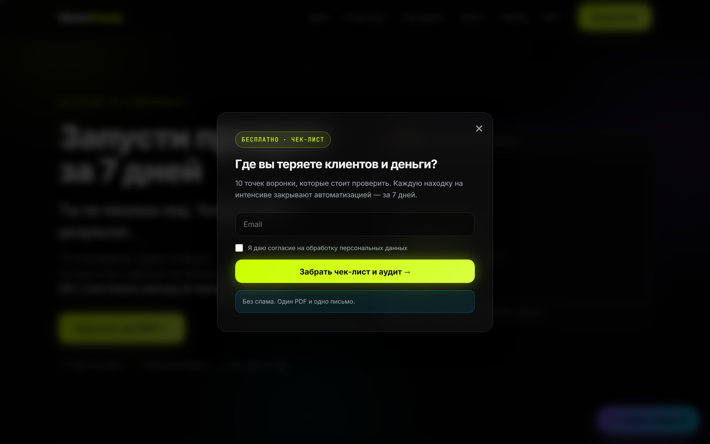
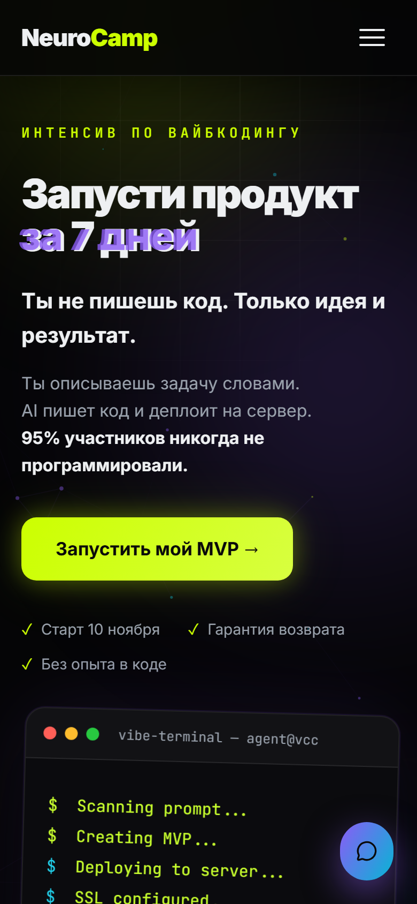

# TANYA'S VIBE CODING LAB

### Вайб-кодер · фрилансер · AI

**Делаю сайты, чат-ботов, калькуляторы и веб-приложения для малого бизнеса и экспертов.**

[Обо мне](#обо-мне) · [Что я делаю](#что-я-делаю) · [Избранные проекты](#избранные-проекты) · [Архив](#архив-экспериментов) · [Направление](#направление) · [Контакты](#контакты)

---

## Обо мне

Я фрилансер и собираю сайты с помощью AI. Работаю с малым бизнесом и экспертами: лендинги, чат-боты, калькуляторы, трекеры.

Веду проект от задачи до запуска: выясняю, что нужно клиенту и зачем, собираю прототип, публикую, дорабатываю по обратной связи. Код не пишу вручную — собираю вместе с OpenCode и Lovable. Поэтому первая версия готова через несколько дней, а не через месяцы.

Раньше я работала методистом онлайн-обучения. Это помогает до сих пор: умею выстроить последовательность — что человек видит первым, куда идёт дальше, в какой момент оставляет заявку. Для меня сайт — не набор блоков, а сценарий.

## Что я делаю

- **Лендинги** — для услуг, экспертов и инфопродуктов. С формой заявки или записи.
- **Калькуляторы** — считают стоимость или смету и попутно собирают заявку.
- **Чат-боты** — ассистенты во ВКонтакте: отвечают на вопросы, подбирают вариант, записывают на консультацию.
- **Веб-приложения и трекеры** — PWA и Telegram Mini Apps: задачи, привычки, настроение.

## Инструменты

- **Vibe coding:** OpenCode, Lovable
- **AI:** ChatGPT, Qwen
- **Код:** HTML/CSS/JS, React, Next.js, Node.js, Supabase, PostgreSQL, PWA, Telegram Mini App, VK API

---

## Избранные проекты

Шесть проектов: лендинги, калькуляторы, чат-бот и трекеры. Ссылки на демо проверены.

### 01 · «Солнечно» — AI-бот турагентства

**Тип:** чат-бот во ВКонтакте

Отвечает на вопросы, подбирает тур по направлению, датам и бюджету, записывает на консультацию и присылает владельцу уведомление о заявке.

**Как устроен:** VK Long Poll API · база знаний · сценарий диалога  
**Стек:** Node.js · OpenAI-совместимый API · VK Long Poll API

- Демо: бот в сообществе, публично не развёрнут
- Репозиторий: пока нет

### 02 · DayWave — трекер настроения и стресса

**Тип:** PWA

Каждый день — отметка настроения и слайдер стресса, раз в неделю видно график. Есть список задач, экспорт и импорт данных, вход по PIN.

**Стек:** PWA · HTML/CSS/JS · localStorage

- Демо: https://tatianaweb-ai.github.io/daywave/
- Репозиторий: https://github.com/tatianaweb-ai/daywave

### 03 · Калькулятор грузоперевозок

**Тип:** десктоп-инструмент

Считает стоимость перевозки: маршрут, вес, объём, габариты, упаковка, страхование, температурный режим. Вводишь объём — вес подставляется сам.

**Статус:** готов к передаче, устанавливается на компьютер

- Демо: не развёрнут, запускается локально
- Репозиторий: пока нет

### 04 · STUDIO — лендинг студии интерьеров

**Тип:** лендинг

Услуги, проекты, форма заявки. Задача была показать работы, а не рассказывать о них.

**Статус:** опубликован

- Демо: https://sitedesigne.netlify.app/
- Репозиторий: пока нет

### 05 · Калькулятор стоимости уборки

**Тип:** пошаговый квиз

Площадь, комнаты, санузлы, окна, балконы, дополнительные опции. На последнем шаге — заявка с готовой суммой.

**Статус:** HTML-версия

- Демо: не развёрнут
- Репозиторий: пока нет

### 06 · NeuroCamp — лендинг интенсива по вайб-кодингу

**Тип:** лендинг с воронкой заявок

Лендинг семидневного интенсива по AI-кодингу. Внутри — интерактивное демо генерации кода, лид-магнит на выходе со страницы (PDF-чек-лист), чат-бот, квиз и формы, которые пишут заявки в Google Таблицу.

**Статус:** живая демо-версия, данные обезличены

- Демо: https://neurocamp.netlify.app/
- Репозиторий: https://github.com/tatianaweb-ai/neurocamp-landing

---

## Архив экспериментов

Остальные прототипы — в работе. Добавляю ссылку, когда проект готов к показу.

### Лендинги — 5

| Проект | Назначение | Ссылка |
|---|---|---|
| LUXE Beauty Salon | Услуги салона и форма записи | [sitebeautyluxe.netlify.app](https://sitebeautyluxe.netlify.app/) |
| Анна Вершинина | Личный сайт психолога, запись на консультацию | [psy.sitebeautyluxe.ru](https://psy.sitebeautyluxe.ru/) |
| Klein's Yoga Balance | Семейная йога онлайн | [yoga.sitebeautyluxe.ru](https://yoga.sitebeautyluxe.ru) |
| STUDIO | Портфолио студии интерьеров | [sitedesigne.netlify.app](https://sitedesigne.netlify.app/) |
| NeuroCamp | Интенсив по AI-кодингу | [neurocamp.netlify.app](https://neurocamp.netlify.app/) |

### Калькуляторы — 5

| Проект | Что считает | Статус |
|---|---|---|
| Грузоперевозки | Маршрут, параметры груза, опции, пересчёт | Устанавливается на компьютер, есть форма заявки |
| Уборка | Площадь, комнаты, санузлы, окна, балконы | Квиз с формой заявки |
| Печать документов | Формат A4/A3, тираж, тип печати, опции | HTML-калькулятор, без формы |
| Каркасный дом | Площадь, этажность, комплектация | HTML-смета, без формы |
| Пополнение услуг | Сервис, сумма, опции | HTML-калькулятор, без формы |

### Трекеры — 3

| Проект | Что умеет | Стек | Ссылка |
|---|---|---|---|
| Дела в порядке | Задачи, проекты, приоритеты, статусы, канбан, вход по magic-link | Next.js 16 · Supabase · PostgreSQL · Row Level Security | [репозиторий](https://github.com/tatianaweb-ai/dela-v-poryadke) |
| Habit Tracker | Привычки, серии, календарь, категории | Telegram Mini App | [репозиторий](https://github.com/tatianaweb-ai/habit-tracker-mini-app) |
| DayWave | Настроение, стресс, задачи, графики, импорт и экспорт, PIN | PWA | [демо](https://tatianaweb-ai.github.io/daywave/) · [репозиторий](https://github.com/tatianaweb-ai/daywave) |

### AI-ассистент — 1

| Проект | Что умеет | Стек |
|---|---|---|
| «Солнечно» | Подбирает туры, отвечает на вопросы, записывает на консультацию | Node.js · OpenAI-совместимый API · VK Long Poll API |

---

## Направление

**Ниша:** малый бизнес и эксперты. Лендинги с понятным предложением и коротким путём к заявке.

Что делаю дальше:

- пакеты услуг с фиксированными ценами — «База» и «База+»;
- больше чат-ботов для консультаций и записи;
- квизы и калькуляторы, которые собирают заявки;
- большой эксперимент в EdTech: лендинг, бот, лид-магнит и квиз в одном проекте.

**Ближайшее:** довести до такого эксперимента NeuroCamp. Бот, лид-магнит, квиз и Google Таблица там уже работают.

---

## Контакты

- GitHub: [@tatianaweb-ai](https://github.com/tatianaweb-ai)

**Открыта к заказам:** лендинги, калькуляторы, чат-боты, веб-приложения.

*Сделать → проверить → запустить → доработать.*

