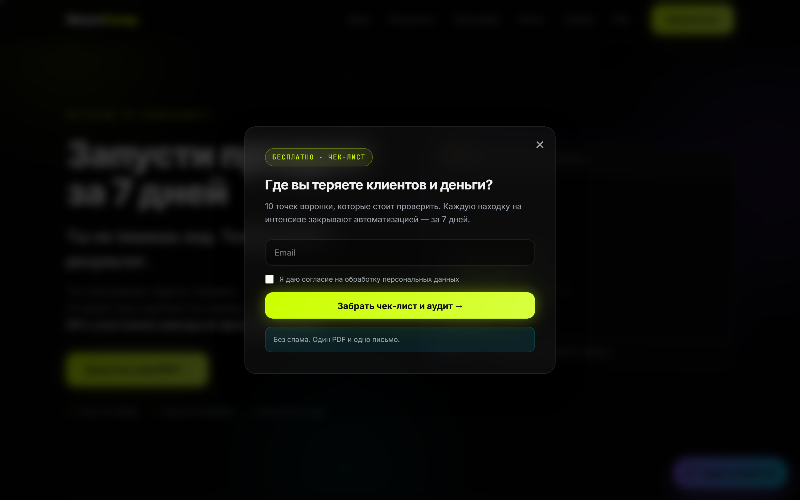
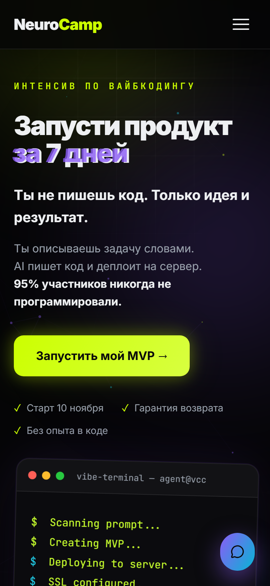

<!--
TANYA'S VIBE CODING LAB — GitHub Profile README
Demo and repository links are filled in and verified (all demo links return HTTP 200).
Still to do before publishing:
1. Upload project screenshots to the /screenshots folder and uncomment the matching image lines.
2. Add socials to the "Find Me" section if needed.
-->

# TANYA'S VIBE CODING LAB

### Vibe Coder · Freelancer · AI

**Sites, chatbots, calculators and web apps for small business and experts.**  
**Сайты, чат-боты, калькуляторы и веб-приложения для малого бизнеса и экспертов.**

[About / Обо мне](#about--обо-мне) · [What I Do / Что я делаю](#what-i-do--что-я-делаю) · [Featured / Избранное](#featured-projects--избранные-проекты) · [Archive / Архив](#experiment-archive--архив-экспериментов) · [Focus & Next / Направление](#focus--next--направление)

---

## About / Обо мне

**EN**

I’m a freelance vibe coder. I turn ideas into working digital products — landing pages, chatbots, calculators, and web apps — for small businesses and experts.

I work end to end: from a real task and user scenario to a prototype, deployment, and iteration. I use vibe coding and AI (OpenCode, Lovable) to move fast without hand-coding every line.

My background is in instructional design and online learning methodology. It helps me build products where the user journey is clear: what to show first, how to guide the next step, and how to turn a visit into a request.

**RU**

Я фрилансер и вайб-кодер. Превращаю идеи в работающие цифровые продукты — лендинги, чат-ботов, калькуляторы и веб-приложения — для малого бизнеса и экспертов.

Работаю «под ключ»: от реальной задачи и пользовательского сценария — к прототипу, публикации и улучшениям. Использую vibe coding и AI (OpenCode, Lovable), чтобы делать быстро, без ручного кода для каждой строки.

Мой фон — instructional design и методология онлайн-обучения. Это помогает строить продукты с понятным пользовательским путём: что показать первым, как вести к следующему шагу и как превратить визит в заявку.

## What I Do / Что я делаю

- **Landing pages / Лендинги** — services, experts, info-products, with a request or booking form.  
  Услуги, эксперты, инфопродукты — с формой заявки или записи.
- **Interactive calculators / Интерактивные калькуляторы** — cost or estimate calculation plus lead capture.  
  Расчёт стоимости или сметы плюс сбор заявок.
- **AI chatbots / AI-чат-боты** — VK assistants for advice, selection, and client booking.  
  Ассистенты ВКонтакте: консультация, подбор, запись клиентов.
- **Web apps & trackers / Веб-приложения и трекеры** — PWA and Telegram Mini Apps: tasks, habits, mood.  
  PWA и Telegram Mini Apps: задачи, привычки, настроение.

## Toolbox / Инструменты и стек

- **Vibe coding:** OpenCode, Lovable
- **AI tools:** ChatGPT, Qwen
- **Stack:** HTML/CSS/JS, React, Next.js, Node.js, Supabase, PostgreSQL, PWA, Telegram Mini App, VK API
- **Approach / Подход:** start with a real task, build a prototype, deploy, iterate.  
  От реальной задачи — к прототипу, публикации и улучшениям.

---

## Featured Projects / Избранные проекты

Six featured projects across four product types: landing pages, calculators, a chatbot, and trackers.  
Шесть избранных проектов в четырёх категориях: лендинги, калькуляторы, чат-бот и трекеры.

> **Note / Примечание:** demo links are live and verified; screenshots are added after the repo is published.  
> **Примечание:** ссылки на демо заполнены и проверены; скриншоты добавляются после публикации репозитория.

### 01 · «Солнечно» — AI Travel Assistant

**Type:** AI chatbot · VK integration

**EN:** An AI-powered assistant for a travel agency. It answers questions, helps users narrow down tour options using a knowledge base, collects destination/date/budget preferences, and supports consultation booking.

**RU:** AI-бот туристического агентства: консультирует, помогает подобрать тур по направлению, датам и бюджету, использует базу знаний и поддерживает запись на консультацию.

**Mechanics:** VK Long Poll API · knowledge base · guided conversation · booking notification  
**Stack:** Node.js · OpenAI-compatible API · VK Long Poll API

- Demo: VK community bot (not deployed publicly / не развёрнут публично)
- Repository: not published on GitHub yet
- Screenshot: add `screenshots/solnechno-bot.png`

<!-- Uncomment after adding the screenshot:

-->

### 02 · DayWave — Mood & Stress Tracker

**Type:** Tracker · PWA

**EN:** A personal PWA for tracking mood, stress level, and tasks. Daily check-ins with five moods and a stress slider, weekly charts, a task list, data export/import, and PIN protection.

**RU:** PWA-трекер настроения, уровня стресса и задач. Ежедневные отметки (5 настроений, слайдер стресса), недельные графики, список задач, экспорт/импорт данных и защита PIN-кодом.

**Mechanics:** daily check-ins · weekly charts · export/import · PIN protection  
**Stack:** PWA · HTML/CSS/JS · localStorage

- Live demo: https://tatianaweb-ai.github.io/daywave/
- Repository: https://github.com/tatianaweb-ai/daywave
- Screenshot: add `screenshots/daywave.png`

<!-- Uncomment after adding the screenshot:

-->

### 03 · Freight Shipping Calculator

**Type:** Interactive calculator · Desktop tool

**EN:** A shipping cost calculator that brings route details, cargo weight/volume/dimensions, and optional services into one workflow. When volume is entered, the tool calculates the corresponding weight automatically.

**RU:** Калькулятор грузоперевозок, который объединяет маршрут, вес, объём и габариты груза, а также дополнительные услуги — упаковку, страхование и температурный режим. При вводе объёма инструмент автоматически рассчитывает вес.

**Mechanics:** one-screen workflow · live recalculation · conditional inputs  
**Status:** ready to hand over as an installable desktop tool.

- Demo / installer: not deployed (runs locally / запускается локально)
- Repository: not published on GitHub yet
- Screenshot: add `screenshots/freight-calculator.png`

<!-- Uncomment after adding the screenshot:

-->

### 04 · STUDIO — Interior Design Landing Page

**Type:** Landing page · Service presentation

**EN:** A landing page for a premium interior design studio, presenting services and projects and guiding visitors toward an enquiry.

**RU:** Лендинг премиальной студии дизайна интерьеров: презентация услуг и кейсов с переходом к форме заявки.

**Focus:** visual storytelling · project showcase · lead generation  
**Status:** published; the hero headline is planned for revision.

- Live demo: https://sitedesigne.netlify.app/
- Repository: not published on GitHub yet
- Screenshot: add `screenshots/studio-landing.png`

<!-- Uncomment after adding the screenshot:

-->

### 05 · Cleaning Cost Calculator

**Type:** Multi-step quiz · Business calculator

**EN:** A step-by-step price calculator. Visitors answer questions about the property — area, rooms, bathrooms, windows, balconies, and extra options — to build a request and estimate the cost.

**RU:** Пошаговый квиз для расчёта стоимости уборки. Пользователь последовательно отвечает на вопросы о площади, комнатах, санузлах, окнах, балконах и дополнительных опциях.

**Mechanics:** multi-step flow · progressive disclosure · option selection  
**Status:** HTML version; further refinement planned.

- Demo: not deployed (HTML version / HTML-версия)
- Repository: not published on GitHub yet
- Screenshot: add `screenshots/cleaning-calculator.png`

<!-- Uncomment after adding the screenshot:

-->

### 06 · NeuroCamp — AI Coding Intensive

**Type:** Educational landing page · Lead funnel

**EN:** A landing page for a seven-day AI coding intensive. The visual direction combines bold typography, glitch-inspired details, and interactive visual elements. It includes an interactive demo of AI code generation, an exit-intent lead magnet (a PDF checklist with a clickable audit button), a chatbot, a quiz, and registration forms wired to a Google Sheet.

**RU:** Лендинг семидневного интенсива по AI-кодингу. Визуальная концепция сочетает выразительную типографику, элементы глитч-эстетики и интерактивную визуализацию. Внутри — интерактивное демо генерации кода, лид-магнит на выходе (PDF-чек-лист с кликабельной кнопкой аудита), чат-бот, квиз и формы записи, подключённые к Google Таблице.

**Focus:** educational product presentation · visual identity · lead generation  
**Status:** live demo with anonymised data / живая демо-версия с обезличенными данными.

- Live demo: https://neurocamp.netlify.app/
- Repository: not published on GitHub yet
- Source: private project folder

---

## Experiment Archive / Архив экспериментов

The featured projects are a starting point, not the whole lab. More prototypes will be added as they are refined.  
Избранные проекты — только начало. Остальные прототипы будут добавляться по мере доработки.

### Landing Pages / Лендинги — 5

| Project | Purpose | Status / Link |
|---|---|---|
| LUXE Beauty Salon | Beauty services and booking form / Услуги салона и запись | [sitebeautyluxe.netlify.app](https://sitebeautyluxe.netlify.app/) |
| Anna Vershinina | Personal website for an analytical psychologist / Сайт психолога и запись на консультацию | [psy.sitebeautyluxe.ru](https://psy.sitebeautyluxe.ru/) |
| Klein's Yoga Balance | Online family yoga / Семейная йога онлайн | [yoga.sitebeautyluxe.ru](https://yoga.sitebeautyluxe.ru) |
| STUDIO | Interior design portfolio / Портфолио студии интерьеров | [sitedesigne.netlify.app](https://sitedesigne.netlify.app/) |
| NeuroCamp | Seven-day AI coding intensive / Интенсив по AI-кодингу | [neurocamp.netlify.app](https://neurocamp.netlify.app/) |

### Calculators / Калькуляторы — 5

| Project | Mechanics | Status |
|---|---|---|
| Freight Shipping | Route, cargo parameters, extras, automatic recalculation / Маршрут, параметры груза, опции, пересчёт | Desktop tool with a request form / Установочный инструмент с формой заявки |
| Cleaning | Multi-step quiz / Пошаговый квиз | Multi-step quiz with a request form / Пошаговый квиз с формой заявки |
| Document Scan | A4/A3, print run, print type, extras / Формат, тираж, тип печати, опции | HTML calculator, no request form yet / Калькулятор, пока без формы |
| Frame House | Area, floors, package / Площадь, этажность, комплектация | HTML estimate calculator, no request form yet / Смета, пока без формы |
| Payment Top-up | Service, amount, options / Сервис, сумма, опции | HTML payment calculator, no request form yet / Калькулятор оплаты, пока без формы |

### Trackers / Трекеры — 3

| Project | Features | Stack / Format | Link |
|---|---|---|---|
| Дела в порядке | Tasks, projects, priorities, statuses, Kanban, magic-link login | Next.js 16 · Supabase · PostgreSQL · Row Level Security | [repo](https://github.com/tatianaweb-ai/dela-v-poryadke) |
| Habit Tracker | Daily habits, streaks, calendar, categories | Telegram Mini App | [repo](https://github.com/tatianaweb-ai/habit-tracker-mini-app) |
| DayWave | Mood, stress, tasks, weekly charts, import/export, PIN protection | PWA | [demo](https://tatianaweb-ai.github.io/daywave/) · [repo](https://github.com/tatianaweb-ai/daywave) |

### AI Assistant / AI-ассистент — 1

| Project | Features | Stack |
|---|---|---|
| «Солнечно» | Tour recommendations, FAQ, consultation booking, owner notification | Node.js · OpenAI-compatible API · VK Long Poll API |

---

## Focus & Next / Направление

**Niche / Ниша:** small business and experts — landing pages with a clear offer and a short path to a request.  
**Ниша:** малый бизнес и эксперты — лендинги с понятным предложением и коротким путём к заявке.

What I'm building toward / Куда двигаюсь:

- Product packages with clear pricing / Продуктовые пакеты с понятным прайсом («База» и «База+»)
- More AI assistants for client advice and booking / Больше AI-ассистентов для консультаций и записи клиентов
- Interactive lead magnets: quizzes and calculators / Интерактивные лид-магниты: квизы и калькуляторы
- A larger EdTech experiment: a landing plus a chatbot, a lead magnet, and a quiz / Больший EdTech-эксперимент: лендинг + чат-бот + лид-магнит + квиз

**Current idea / Ближайшая идея:** develop the NeuroCamp educational landing into a fuller experiment — the chatbot, lead magnet, quiz, and Google Sheet integration are already in place.  
Постепенно развить образовательный лендинг в целостный эксперимент — чат-бот, лид-магнит, квиз и интеграция с Google Таблицей уже реализованы.

---

## Find Me / Контакты

- GitHub: [@tatianaweb-ai](https://github.com/tatianaweb-ai)
- Other links / Другие ссылки: **add if needed**

**Open to freelance projects / Открыта к заказам:** landing pages, calculators, chatbots, web apps.  
Лендинги, калькуляторы, чат-боты, веб-приложения.

*Build → test → deploy → iterate.*  
*Создавать → проверять → публиковать → улучшать.*

